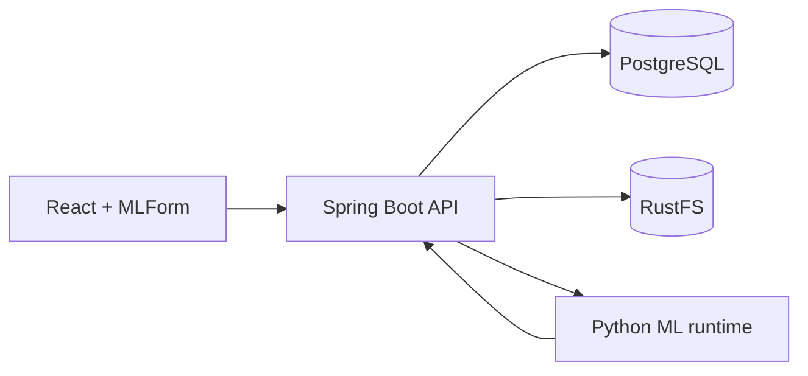

<p align="center">
  
</p>

<h1 align="center">
  <picture>
    <source media="(prefers-color-scheme: dark)" srcset="https://raw.githubusercontent.com/UlloaSP/mlsuite/main/brand/wordmark-dark.svg" />
    
  </picture>
</h1>

<p align="center">From trained model to reviewed prediction.</p>

<p align="center">
  <a href="https://mlsuite.eshkra.dev"></a>
  <a href="https://docs.mlsuite.eshkra.dev"></a>
  <a href="https://mlsuite.irlab.org"></a>
  <a href="https://github.com/UlloaSP/mlsuite"></a>
  <a href="https://github.com/UlloaSP/mlsuite/actions/workflows/ci.yml"></a>
  <a href="https://github.com/UlloaSP/mlsuite/blob/main/LICENSE"></a>
  <a href="https://eshkra.dev"></a>
</p>

MLsuite turns trained machine-learning models into reproducible, reviewable
applications. Upload a model, run single or bulk predictions through a form
generated from its schema, collect human reviews and corrections, and export
everything for evaluation or retraining.

It is a deployed product, not a library: a React frontend, a Spring Boot API and
a Python ML runtime, with PostgreSQL for application state and RustFS for
artifacts, all run by Docker Compose. Try the [live deployment](https://mlsuite.irlab.org)
or self-host your own.

## Why MLsuite?

Testing a model with real users usually means rebuilding the same infrastructure:
artifact storage, input validation, custom forms, prediction history,
permissions, review workflows and exports.

MLsuite puts that loop in one open-source product. Serving a `predict()`
endpoint is not the goal. The goal is to preserve exactly which model and schema
produced a result, let people inspect and correct it, and turn those corrections
into useful data. Nothing is for sale: if MLsuite goes in the wrong direction,
the full stack is here to inspect, change and fork.

## What it does

- Store and manage trained model artifacts.
- Analyze model inputs and generate versioned schemas.
- Render schemas as validated forms with MLForm.
- Run individual and bulk predictions.
- Preserve prediction history with exact model and schema identity.
- Collect reviews, corrections, questionnaires and explanation feedback.
- Extend reports and fields through plugins.
- Export inputs, outputs and feedback for downstream work.
- Publish a schema bookmark to a public page at `/explore/<id>`, listed in the
  public feed at `/explore`, where anyone, signed in or not, can fill its form
  (with saved runs you mark as examples) and run it. Every public run is kept as
  one of the organization's inferences, marked as made on the public page, and
  the browser that made it finds it again under **Your runs**, where the visitor
  can review its results without an account.
- Give an organization a logo, shown beside its name in the workspace and on its
  public pages, and give a public bookmark a publication note (the paper it was
  published in, a DOI, terms of use). Links shared to a public page unfurl with
  the bookmark's name, text and the publisher's logo.
- Let outside software run an organization's bookmarks through the
  [client API](#client-api) with keys, usage metering and limits.
- Manage organizations, teams, roles, invitations and workspace permissions, and
  read who did what in the organization's audit log (roles with
  `VIEW_AUDIT_LOG`): every action by members, API clients, public visitors and
  the system, kept 7 days by default.
- Let superadmins review every public bookmark on the instance and unpublish any
  of them, watch every organization's API traffic, and read one audit log across
  every organization and the platform's own events.
- Monitor the local Compose stack through the operations service.

## Where it fits

MLsuite is the last step of the [eshkra](https://eshkra.dev) path from a trained
model to reviewed predictions. Each project also works on its own.

| Step | Project | Role |
| --- | --- | --- |
| Package | [MLbundle](https://mlbundle.eshkra.dev) | Writes the model, manifest and schema into one `.mlbundle` file. |
| Describe | [MLschema](https://mlschema.eshkra.dev) | Infers the field schema MLbundle stores, from the training DataFrame. |
| Render | [MLform](https://mlform.eshkra.dev) | Draws the schema as the prediction form and its reports. |
| Run and review | **MLsuite** | Runs predictions, collects feedback and keeps every result traceable. |

### Model artifacts

MLsuite accepts `.mlbundle` files exported with
[mlbundle](https://github.com/UlloaSP/mlbundle) 0.1.0a2 or later for tabular
classification and regression, and no other artifact format, no separate
DataFrame and no bundle written by an earlier mlbundle version. A bundle carries a
scikit-learn, XGBoost, CatBoost or ONNX model in its native pickle-free format
with its manifest and schema, and MLsuite uses that schema as it comes: export
with `training_data=` to infer the fields from the training frame; otherwise
every feature is a number field.

Each model runs in its own environment. A bundle from mlbundle 0.3 or later carries
`pylock.toml`, the exact Python and distributions it was trained with; MLsuite
accepts it only when `backend/environment-allowlist.toml` names that Python, that
mlbundle release and every locked package at its exact version, then installs the
environment once (models needing the same files share it) and loads the model
there before anyone runs it. Until then the model is *preparing*; a bundle that
cannot load or predict its samples there is *failed* with the reason, and a member
who may edit models can have it prepared again. Bundles written before locks run in
the runtime's frozen legacy environment (mlbundle 0.2.1, scikit-learn 1.9.1). Every
stored result keeps the environment that computed it. To allow a new version, add
it to the allowlist once bundles needing it reproduce their predictions on the
production host.

Fields map to the model's own feature names; a model without them takes its
features by position, so its fields map to `0`, `1`, …. One-hot columns are
grouped with the separator the bundle was exported with. Every model output has
its own report, mapped to the output's position. A scikit-learn bundle loads only
with the scikit-learn version that exported it, which is the version pinned in
`backend/pyproject.toml`. Crystal Tree explanations apply to supported
decision-tree estimators only.

## Getting started

> [!WARNING]
> MLsuite is early software. Expect rough edges and breaking changes.

You need Git and Docker with Docker Compose. Clone the repository and create
your environment file:

```bash
git clone https://github.com/UlloaSP/mlsuite.git
cd mlsuite
cp .env.example .env
```

On Windows PowerShell, use `Set-Location mlsuite` and `Copy-Item .env.example .env`.

Open `.env` and give every blank secret its own value, especially `DB_PASS`,
`STORAGE_SECRET_KEY`, `OPS_AGENT_SHARED_SECRET`, `PREDICTION_ATTESTATION_SECRET` and
`MLSUITE_SUPERADMIN_PASSWORD`.
The ops-agent controls the host's Docker and refuses to start without
`OPS_AGENT_SHARED_SECRET`. Keep `.env` private; commit only sanitized defaults to
`.env.example`.

Start the development stack:

```bash
docker compose -f docker-compose.yml -f docker-compose.dev.yml up --build -d
```

Then open <http://localhost:5173>. Without a session it shows the public feed at
`/explore`, whose header offers **Sign in** and **Create account** and brings you
back to the page you were on. Sign in at [`/login`](http://localhost:5173/login)
with the superadmin account configured in `.env`, or register at
[`/login?mode=register`](http://localhost:5173/login?mode=register): a new account
gets its own personal organization.

Inspect, follow and stop the stack with the same files:

```bash
docker compose -f docker-compose.yml -f docker-compose.dev.yml ps
docker compose -f docker-compose.yml -f docker-compose.dev.yml logs -f
docker compose -f docker-compose.yml -f docker-compose.dev.yml down
```

A database or bucket created before the current baseline cannot be upgraded;
recreate them with `down -v`.

## Deploying

### Compose topology and releases

`docker-compose.yml` is the single operational topology. The development override
builds local application images. `docker-compose.prod.yml` supplies
production-only operational metadata and has no image defaults: its mandatory
release override, `docker-compose.release.yml`, supplies every application image
pinned by digest. CI compares the fully rendered models and rejects any other
drift.

Services share a network only with the services they call: `edge` joins the
frontend, the API and the ops-agent; `data` joins the API, its one-shot jobs,
PostgreSQL and RustFS; `runtime` joins only the API and `py-analyzer`. The runtime
runs uploaded models, so its network is internal and reaches neither the
ops-agent, the stores nor the internet. `runtime-builder` installs model
environments into the `runtime_environments` volume, which the runtime mounts
read-only; it alone reaches the package index (`egress`), and only the API reaches
it (`build`, internal). Only the frontend is published on every
interface; PostgreSQL is published on `127.0.0.1` alone, because Docker-published
ports bypass host firewalls such as ufw. The API starts once `py-analyzer` reports
healthy on `/health`. Docker rotates every container's log at 10 MB and keeps five
files per container.

Successful publications from `main` create immutable `build-<commit>` releases
with digest-pinned images and a Compose override; MLsuite does not update
`latest`. Read [release selection and verification](./docs/RELEASES.md) before
using published images. The release bundle supplies verified artifacts;
deployment, migration, backup, readiness, promotion and rollback remain operator
responsibilities.

### Websites

`landing/` and `docs/` deploy to Cloudflare Workers Static Assets as `mlsuite-landing`
(`mlsuite.eshkra.dev`) and `mlsuite-docs` (`docs.mlsuite.eshkra.dev`). CI checks and builds
both sites and validates their Wrangler configuration without uploading. Only when every CI
job passes on a push to `main`, or on a manual CI run on `main`, are the tested builds
deployed without rebuilding, each through its own GitHub environment (`landing`, `docs`)
limited to `main`, followed by an HTTPS check of the homepage title. Pull requests, forks and
`develop` never deploy. The repository needs the Actions secrets `CLOUDFLARE_API_TOKEN` and
`CLOUDFLARE_ACCOUNT_ID`. To roll back, revert the change and merge it to `main`.

### Production cutover

For a real cutover, run the repeatable, gated operator wizard from the repository
root: `./scripts/production-cutover.sh`. It creates coordinated backups, requires
an isolated restore rehearsal, runs the database migration, checks readiness and records
the rollback prerequisites. Review the procedure first; it changes the configured
production environment only after explicit confirmations. It records the base,
production and digest-pinned release files in `OPS_AGENT_COMPOSE_FILES` so
operational restarts use the same release.

### Backups and recovery

The initial supported on-premise topology is explicitly `local-single-disk`. The
wizard creates a coordinated PostgreSQL plus RustFS recovery point, checksums it,
restores it in an isolated environment, and requires an explicit acknowledgement
that physical disk loss is not covered. These local backups protect against a bad
deployment or logical deletion; they are not PITR or disaster recovery. The
documented initial objective is a 24-hour logical-recovery RPO and an 8-hour RTO.

Install the persistent daily systemd timer once on the Linux host, using the
account that can access Docker, and run or verify the same backup manually:

```bash
sudo bash ./scripts/install-backup-timer.sh .env <service-user>
systemctl list-timers mlsuite-backup.timer

ENV_FILE=.env ./scripts/create-local-backup.sh
ENV_FILE=.env bash ./scripts/verify-backup-rpo.sh
```

The timer runs daily even after a schedule missed during downtime. The cutover
refuses to proceed unless it is enabled and the newest checksummed backup
satisfies `RECOVERY_RPO_MINUTES`. Its isolated restore rehearsal is timed, must
finish within `RECOVERY_RTO_MINUTES`, and records the measured duration in
`RECOVERY_LAST_RTO_SECONDS` and the result in `RECOVERY_LAST_RESTORE_RESULT`. A
failed rehearsal stops the cutover and stays visible instead of leaving a stale
successful result.

The backup command pauses the frontend and API, dumps PostgreSQL, takes a cold
archive of RustFS that preserves version IDs, verifies checksums, and only then
prunes the oldest backups down to `LOCAL_BACKUP_RETENTION_COUNT`; a refused or
failed run never removes an existing backup, so the disk briefly holds one backup
more than the retention count. It then checks the remaining disk space and
restarts only the application services that were running. Backups live under
`LOCAL_BACKUP_ROOT`, outside the Docker data volumes but currently on the same
physical disk. Keep at least 15% free with `LOCAL_BACKUP_MIN_FREE_PERCENT`. Before
stopping writes, the command requires headroom for both the archive and the
restore rehearsal: roughly 2.5 times the live PostgreSQL plus RustFS data, on top
of that reserve.

### Database and storage

Flyway is the only schema owner; Hibernate validates the result and never creates
or updates production tables. The release runs the same immutable API image in a
one-shot `db-migrate` service before the API may start.

An installation starts from an empty database and an empty bucket:
`api/src/main/resources/db/migration/V1__baseline.sql` creates the whole schema. A
database created before that baseline cannot be upgraded and Flyway refuses it, so
wipe the PostgreSQL and RustFS volumes before starting this release.

The coordinated local backup archives RustFS cold, preserving object versions,
delete markers and the version IDs that PostgreSQL references; keep the RustFS
image pinned when restoring it. Until another physical device exists, record disk
or host loss as an accepted, unrecoverable risk. Do not configure lifecycle expiry
on the bucket inside the rollback window.

Compose provisions three PostgreSQL roles idempotently: `DB_ADMIN_USER` owns the
service, `DB_MIGRATION_USER` owns DDL and Flyway objects, and `DB_USER` receives
only the DML privileges the application needs. Use distinct credentials in
production; on an externally managed database, create equivalent roles before
running Compose. The migration role must be allowed to install `pg_trgm`, or a
database administrator must install it first.

RustFS follows the same separation. `RUSTFS_ACCESS_KEY` and `RUSTFS_SECRET_KEY` are
used only by RustFS and its one-shot initializer. `STORAGE_ACCESS_KEY` and
`STORAGE_SECRET_KEY` identify a separate application user whose generated policy
is restricted to the configured bucket. The API and the `artifact-prune` job never
receive the root credentials.

### Model artifacts

Object storage is the only home of model artifacts, so the API needs RustFS to
store and run models. An upload is streamed into RustFS under a key of its own,
read back and compared with its SHA-256, and only then is the model's row written.
Reads and runs use the exact RustFS version ID persisted in PostgreSQL, not
whichever version is latest, and verify the SHA-256 as they stream.

A crash between storing the object and committing the row leaves an object nothing
refers to. The one-shot `artifact-prune` job removes those:

```bash
docker compose --env-file .env -f docker-compose.yml -f docker-compose.prod.yml \
  -f docker-compose.release.yml \
  --profile operations run --rm artifact-prune
```

It removes only unreferenced model objects older than
`ARTIFACT_ORPHAN_GRACE_SECONDS` (24 hours by default), rechecking the database
immediately before deleting the exact current object version; plugin objects and
unknown key layouts are outside its scope. It is an operator's job, never
scheduled: run it only against the database that owns the bucket, since an object
unknown to any other database looks like an orphan.

### Promotion and rollback

Production promotion gates are:

- `db-migrate` completed and Flyway validation has no drift;
- `/actuator/health/readiness` is healthy on the canary API;
- a PostgreSQL plus RustFS restore has been exercised in an isolated environment.

`MODEL_MUTATIONS_REQUIRE_VERSION=false` exists only for a controlled
compatibility window before promotion, so an already-open older frontend can
mutate models without the new parameter. The production cutover requires `true`:
old cached clients must refresh, missing versions receive `428 Precondition
Required`, and mismatched versions receive `409 Conflict`. New clients always send
the version and keep stale-write protection.

Deploy backward-compatible API instances gradually. On application failure, roll
back the image. On an incompatible persistent state, prefer roll-forward or restore
PostgreSQL and RustFS together.

### Concurrency and monitoring

The API serves concurrent clients with one transaction per request, database
constraints as the final authority, and optimistic versioning on models: of two
clients changing the same model, the stale request receives `409 Conflict`. Hikari
bounds database concurrency with `DB_POOL_MAX_SIZE`, `DB_POOL_MIN_IDLE` and
`DB_POOL_CONNECTION_TIMEOUT_MS`; size the pool from the PostgreSQL connection
budget, leaving capacity for the migration job and operations, rather than
matching it to the HTTP thread count.

Runtime calls hold no database connection: a prediction or explanation resolves
its model in short reads and waits for the runtime outside any transaction. Each
kind of caller has its own share of the runtime: `WORKSPACE_PREDICTION_MAX_CONCURRENT`
(default `4`) for workspace members' predictions, explanations and artifact
inspections, and the public and client shares below. A call that finds its share in
use waits its turn in arrival order. It takes its place in the queue before any
database work, and receives `503 Service Unavailable` with `Retry-After` only when
`RUNTIME_QUEUE_MAX_WAITING` calls (default `1000`) already wait in its share, when
its caller (a member, a public page's network or account, an API client) already
holds `RUNTIME_QUEUE_MAX_PER_CALLER` places in the share, running or waiting
(default `16`), or when its turn does not come within `RUNTIME_QUEUE_MAX_WAIT_MS`
(default `5000`). Once admitted, a prediction or explanation must be answered by the
runtime within 10 seconds and an artifact inspection within 50, below the 60 seconds
nginx waits for the API. The API keeps its connections to the runtime open for
reuse, and serves requests on virtual threads, so calls waiting for the runtime do
not delay unrelated requests. Bulk uploads run on the server as jobs through the
same workspace share, 100 records at a time, as the member who started them; an
upload holds at most `PREDICTION_JOBS_MAX_ROWS` records (default `10000`), and at
most `PREDICTION_JOBS_MAX_OPEN_PER_MEMBER` uploads per member (default `2`) and
`PREDICTION_JOBS_MAX_OPEN_PER_ORGANIZATION` per organization (default `4`) are
queued or running at once. A call
names its model's artifact by SHA-256; the API sends the artifact only when the
runtime answers that it does not hold it, and the runtime checks the bytes against
that hash. The runtime is one asynchronous process that runs models in at most
`RUNTIME_WORKERS` worker processes in all (default `2`; about one per core it may
use), each running one request at a time inside one model's environment; a busy
environment takes several, and an idle worker gives way to another environment's.
Its health check stays answered while models run. A worker keeps the bundles it
loaded while their artifacts total at most `RUNTIME_BUNDLE_CACHE_MB` (default
`512`; the newest is kept even when larger), and the runtime keeps received
artifacts on disk under the same bound, so the API sends an artifact once. Size
the workers by memory as well as cores, and bound the runtime with
`RUNTIME_MEMORY_LIMIT` (default `6g`) on a shared host.

Monitor `storageDeletionQueue` on `/actuator/info` and alert on any `failed` row
or a `pending` count that grows continuously. Cleanup workers use database leases,
so several API instances process disjoint tasks and an expired worker cannot
complete or fail work reclaimed by another instance.

### Sign-in and sessions

- **Session cookie.** The session cookie is HttpOnly, SameSite=Lax and, unless
  `SESSION_COOKIE_SECURE=false`, Secure: browsers send it only over HTTPS. They
  treat `http://localhost` as secure, so local development needs no change; set
  `false` only to use plain HTTP on another address.
- **Session lifetime.** Signing in always continues under a new session id. A
  session lasts only while its account is as it was at sign-in: once a superadmin
  disables or deletes the account, resets its password or changes its system role,
  the session ends on its next request, which receives `401 Unauthorized`.
  Workspace roles and permissions are read on every request and apply at once
  without ending the session.
- **Organization per request.** The app names its tab's organization on every
  request in the `X-MLSuite-Organization` header, and the API checks the account's
  membership in it each time (a superadmin may name any). A request that names none
  acts in the organization the account last selected, which is also where a new tab
  opens. Two tabs on two organizations therefore each read and write their own.
- **Throttling.** One client network may fail to sign in `AUTH_MAX_LOGIN_FAILURES`
  times (default `10`) and attempt to register `AUTH_MAX_REGISTRATIONS` times
  (default `5`) in the 15 minutes after its first counted attempt. Past either
  limit it receives `429 Too Many Requests` with `Retry-After` until that window
  ends, even with the right password. Successful sign-ins are not counted and do
  not reset the failures. The network is the client address as for public runs
  (see [Client address behind a proxy](#client-address-behind-a-proxy)). Counts
  live in the API process memory: they restart with the API and are correct only
  with a single API instance.

## Public bookmarks

Public bookmarks run on the same runtime as every workspace, for visitors without
an account.

- **Model size.** `PUBLIC_PREDICTION_MAX_MODEL_SIZE_MB` (default `50`) is the
  largest model artifact a public bookmark may bind. Publishing, moving a public
  bookmark to another snapshot and each public run are refused above it, because
  the runtime must load the artifact of every model it runs. The same limit
  applies to API client runs.
- **Concurrency.** `PUBLIC_PREDICTION_MAX_CONCURRENT` (default `2`) public runs may
  execute at once; further ones wait their turn as described in
  [Concurrency and monitoring](#concurrency-and-monitoring), each network or account
  holding at most `RUNTIME_QUEUE_MAX_PER_CALLER` places. API clients have a share of
  their own, so neither can take the other's.
- **Quota.** Each caller may run one public bookmark a limited number of times in
  24 hours, counted from their first run of it:
  `PUBLIC_PREDICTION_ANONYMOUS_RUNS_PER_DAY` (default `50`) per client address
  without a session (an IPv6 address counts as its /64 network) and
  `PUBLIC_PREDICTION_SIGNED_IN_RUNS_PER_DAY` (default `500`) per signed-in account,
  wherever it connects from. Past the limit the run receives `429 Too Many
  Requests` with `Retry-After`; a run the server could not perform (`502`, `503`)
  is not counted. Counts live in the API process memory: they restart with the API
  and are correct only with a single API instance, since each further instance
  would allow the full limit on its own.

A public run is stored like a workspace run, with its inputs, each model's result
and any feedback, and is listed in the organization's Inferences with the origin
"Public page"; it is never expired or deleted on its own. The browser that made it
is named by a visitor id the API issues in the `mlsuite_visitor` cookie on the
first run (HttpOnly, SameSite=Lax, sent only to `/api/public`, kept a year, marked
Secure behind HTTPS). With it the page lists that browser's runs of the bookmark
and lets the visitor review each one, storing the answers as that visitor's. A
signed-in account running the public page keeps the browser's session and adds its
name to the run. The quota is still counted by network, not by cookie, so clearing
cookies gives no more runs.

A public page is drawn by the browser, so the `frontend` nginx sends
link-unfurling crawlers (social networks, chat apps) to
`/api/public/bookmarks/<id>/preview`, a page of Open Graph tags that redirects
anyone else to the bookmark. Its image is the organization's logo, readable by
anyone at `/api/public/organizations/<org id>/logo`, or the MLsuite mark when the
organization has none. Logos are PNG or JPG uploads of up to 2 MB, cropped to a
square and stored lossless as 256-pixel PNG in the database.

### Client address behind a proxy

The client address comes from one place: the bundled nginx sends the peer it
accepted as `X-MLSuite-Client-Address`, overwriting any value the client sent, and
the API reads only that header, never `X-Forwarded-For`. Keep the API reachable
only through that nginx, as the Compose files do.

When another reverse proxy or TLS terminator sits in front of nginx, every visitor
arrives from that proxy's address and would share one count, so tell nginx which
proxy to trust. Mount a file like this one into the `frontend` container as
`/etc/nginx/conf.d/real-ip.conf`, naming the address or network your proxy
connects from:

```nginx
set_real_ip_from 10.0.0.5;
real_ip_header X-Forwarded-For;
real_ip_recursive on;
```

The proxy must set or append to `X-Forwarded-For` itself. Do not list a network
visitors can connect from, or they could choose their own address again.

## Client API

Outside software runs an organization's bookmarks as one of its **API clients**.
Members with the `MANAGE_API_ACCESS` permission manage them in the app's **API**
section; members with `VIEW_API_ACCESS` can read it. They create a client named
after the software, issue it keys and give it bookmarks. Keys (`mls_...`) are
shown once, stored only as their SHA-256, never expire and are revoked by
deletion; a client may hold several so a key can be replaced without stopping the
software. A client runs exactly the bookmarks it was given, public or not, while
their schema is active and their snapshot binds exactly one model under the
public model size limit. Every change is kept in the organization's audit log.

```http
POST /api/v1/bookmarks/<bookmark id>/predictions
X-MLSuite-Key: mls_...
Content-Type: application/json

{"features": {"age": 52, "sex__male": 1, "sex__female": 0}}
```

The bookmark id is the opaque id the API section shows, the same one its public
page uses, assigned when the bookmark is first published or given to a client.
Features go under the model's own signature feature names; each value is a
number, a boolean, a text of at most 256 characters, or null, and only the runtime
checks the record against the model. The answer says what ran and gives the
model's outputs in output order:

```json
{"requestId": "3f0c6a8e-…", "bookmark": {"id": "…", "name": "production"},
 "snapshot": {"version": 3, "name": "Baseline"}, "model": {"name": "risk-forest", "sha256": "…"},
 "outputs": [{"prediction": "high", "probabilities": {"low": 0.2, "high": 0.8}}, {"value": 41.5}]}
```

Every refusal is an RFC 9457 problem (`application/problem+json`) with a stable
`code`: `invalid_body` and `invalid_features` (400), `invalid_key` (401),
`client_suspended` (403), `bookmark_not_found` (404, also for a bookmark the
client was not given), `bookmark_not_runnable` and `bookmark_changed` (409),
`features_rejected` (422, with the runtime's reason), `rate_limited` and
`quota_exceeded` (429), `internal_error` (500), `runtime_failed` (502) and
`runtime_busy` (503). 429 and 503 carry `Retry-After`. The endpoint accepts any
origin without credentials and exposes `X-Request-Id` and `Retry-After`. A key in
browser JavaScript is readable by anyone who loads the page, so call it from a
backend.

Each call made with a valid key is logged in `api_request` under the `requestId`
it was answered with (also sent as `X-Request-Id`): client, key prefix, bookmark,
status, problem code, duration and the inference it made, never the features or
outputs, which stay in the run. The run is kept as the organization's inference
with the origin "API" and the client's name as its author. The log is the
metering: the API section shows each organization its usage, request log and
endpoint docs, and superadmins see every organization's traffic under **API
traffic**, where they suspend a client (with a reason its organization reads) or
set an organization's monthly limit, both audited.

| Setting | Default | Limit |
| --- | --- | --- |
| `API_ACCESS_REQUESTS_PER_MINUTE` | `60` | Calls one client may make in a clock minute. |
| `API_ACCESS_MONTHLY_CALLS` | `10000` | Succeeded calls an organization's clients may make together in a calendar month (UTC), unless a superadmin set its own limit. |
| `API_ACCESS_MAX_CONCURRENT` | `2` | Client runs executing at once; more wait their turn, as workspace runs do. |
| `API_ACCESS_REQUEST_RETENTION_DAYS` | `90` (at least `31`) | How long calls are kept. |
| `AUDIT_RETENTION_DAYS` | `7` (at least `1`) | How long audit log entries are kept. |

The limits are counted from the log, so they hold across restarts and API
instances; calls still running are counted once they end.

The client API replaced the bookmark API keys of
`POST /api/public/model-predictions`, which no longer exists. Upgrading turns each
key into a client key that keeps its secret: the keys an organization issued under
one consumer name become one client that may run each of their bookmarks, now
whether or not they are public. Consumers must move to the new path and body.

## Architecture



The browser sends authenticated requests to Spring. Only `/api/public/**` answers
without a session, and it serves nothing but bookmarks a member with the publish
permission made public: their form, the inputs of the runs that member marked as
examples, and runs of their models, routed by Spring and stored as the
organization's inferences under the visitor who made them. The client API under
`/api/v1` answers to client keys instead of sessions. Spring enforces workspace
permissions, stores durable state and delegates artifact analysis and prediction
to Python. Results return through Spring, so model, schema, input, output and
feedback identities remain traceable.

Persistence is abstracted by capability, not by a generic database wrapper.
Spring Data repository interfaces isolate aggregate persistence, while
`StorageDeletionWorkQueue` hides the PostgreSQL-specific claiming of asynchronous
cleanup. It uses per-claim fencing tokens, leases and `FOR UPDATE SKIP LOCKED`, so
concurrent workers claim disjoint rows and late workers cannot finalize reclaimed
work. Object storage remains a separate port because it is a genuinely external
system with different failure and consistency modes.

## Development

Read [CONTRIBUTING.md](./CONTRIBUTING.md) and [AGENTS.md](./AGENTS.md) before
changing code. Run focused checks for the component you changed, and use the
integrated Compose stack when a change crosses service boundaries.

The frontend uses [Vite+](https://viteplus.dev/) through the global `vp` command.
Read the [frontend architecture](./frontend/ARCHITECTURE.md) and the
[design system](./DESIGN.md) before working on it.

```bash
cd frontend
vp i
vp check
vp test
```

The Spring API requires Java 25 and Maven:

```bash
cd api
mvn test
```

The API's JSON contract lives in `api/openapi.json`, and the frontend types in
`frontend/src/shared/api/openapi.gen.ts` are generated from it. After changing a
controller or DTO, run `mvn test -Dtest=OpenApiContractTest -Dopenapi.update=true`
in `api/`, then `vp run api:types` in `frontend/`. CI fails when either file is
stale.

The Python runtime requires Python 3.14+ and `uv`:

```bash
cd backend
uv sync --extra dev
uv run pytest tests
```

## Documentation and community

- [Documentation](https://docs.mlsuite.eshkra.dev)
- [Immutable releases](./docs/RELEASES.md)
- [CI and repository protection](./.github/CI.md)
- [Contributing](./CONTRIBUTING.md), [Security policy](./SECURITY.md) and
  [Code of Conduct](./CODE_OF_CONDUCT.md)

MLsuite is research-driven, early and currently centered on Python model
runtimes; expect bugs. Its contracts are designed to support more model types
without making the UI or API depend on one framework.

Report bugs through [Issues](https://github.com/UlloaSP/mlsuite/issues), propose
features in [Ideas](https://github.com/UlloaSP/mlsuite/discussions/categories/ideas)
and ask usage questions in [Q&A](https://github.com/UlloaSP/mlsuite/discussions/categories/q-a).
For large features or contract changes, agree on direction before implementation.

## License

MLsuite is available under the [MIT License](./LICENSE).
